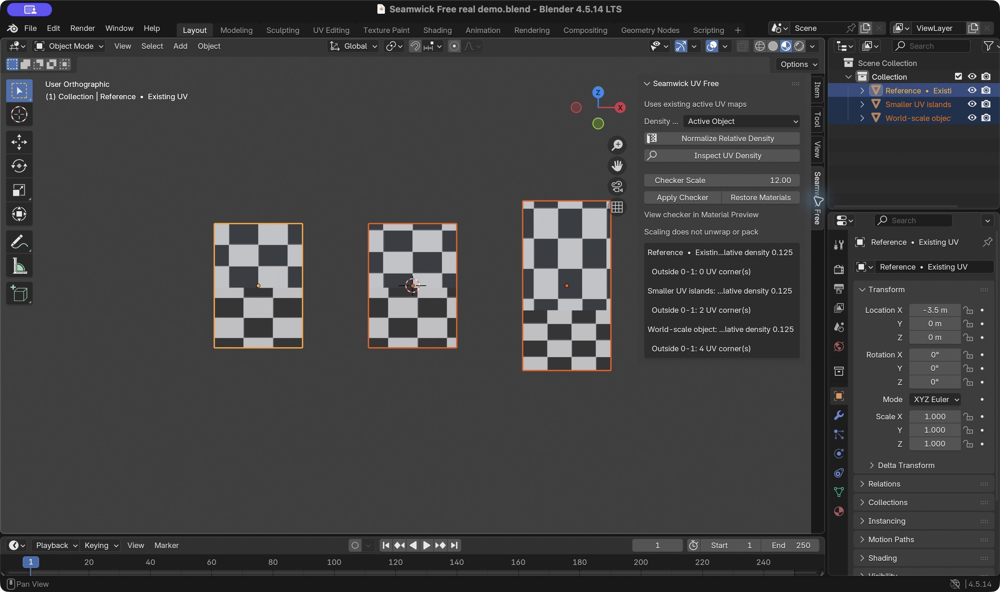

# Seamwick UV Free

**0.1.0 correction in progress:** graphical Blender 4.5.14 testing found that density normalization does not restore the original UVs on Undo. Do not use this operation on production meshes until the corrective release is available. The checker Undo and material restoration tests passed. See [QA](docs/QA.md) for the evidence and scope.

Seamwick UV Free is a standalone Blender UV workflow utility. It matches the relative UV density of existing islands across selected mesh objects and provides a reversible procedural checker preview. It does not require the full Seamwick UV add-on.

## Workflow

1. Download `seamwick_uv_free-0.1.0.zip` from [Releases](https://github.com/yl124915300-dot/seamwick-uv-free/releases/latest). Leave it zipped. Install it using **Preferences > Get Extensions > Install from Disk** and enable **Seamwick UV Free**.
2. Select one or more mesh objects that already have valid UV maps. Open **3D Viewport > N > Seamwick Free**.
3. Choose **Active Object** to use the active mesh's overall density, or **Selection Average** for the area-weighted density of all selected meshes.
4. Click **Normalize Relative Density**. Every island in each selected object's active UV map is scaled around its existing UV corner-coordinate center. In Edit Mode this operates on all islands of the selected objects, regardless of component selection.
5. Click **Inspect UV Density** to inspect island counts, relative density and UV corners outside the 0–1 tile.
6. Click **Apply Checker**, switch the viewport to **Material Preview**, and inspect the checker. Adjust Checker Scale and apply again if needed. **Restore Original Materials** restores the saved material slots and face assignments, including after save/reopen.

Normalization is based on the original mesh's tessellated surface triangles transformed into world space; unapplied modifier output is not included. The result is a relative density match, not an absolute pixels-per-unit measurement. Scaling may create overlaps or move corners outside the tile. The tool does not unwrap, pack, detect overlaps, or claim distortion-free UVs. Restore checker materials before disabling/uninstalling the extension. If you change topology while the checker is active, inspect face material assignments after restoration; newly added faces use the first restored material.

## Scope

- Included: existing-UV island density normalization, world-transform-aware area measurements, procedural checker preview, original material restoration, basic density and tile-bound inspection.
- Excluded: automatic seams, hard-surface and organic seam workflows, unwrap, shared 0–1 atlases, batch packing and seam preview.
- No network requests, telemetry, subscriptions, third-party Python packages or extension permissions.
- Changes reject linked/override objects or mesh data, multi-user meshes, missing UV maps, zero-area triangles and non-finite UV/world coordinates before modifying any selected object. Use local, single-user data and valid non-degenerate UVs.
- Other UV maps, seams, object transforms and geometry are preserved.

## Compatibility and QA

Verified on macOS Apple Silicon in **Blender 4.5.14 LTS, 5.1.2 and 5.2.2 LTS**. Each version passed installation and enablement of the Extensions ZIP, 16 independent functional checks, and a separate process reopening the saved scene with normalized UVs and checker material backups. The installed Python files matched the release source.

The manifest sets Blender 4.5.14 as the minimum and restricts this release to `macos-arm64`. Other Blender versions, Windows, Linux and Intel macOS runtime compatibility are unverified. See the [QA report](docs/QA.md) for the exact scope and GUI checks.

## Source and license

Complete Python source is in `extension/`. Build an installable ZIP with `python3 scripts/build_package.py`; the resulting ZIP has `blender_manifest.toml` and `__init__.py` at its root. Source code is **GPL-3.0-or-later**. See [LICENSE](LICENSE) and [THIRD_PARTY_NOTICES.md](THIRD_PARTY_NOTICES.md).

Copyright (C) 2026 yulei. The area-matching mathematical helpers are extracted from the existing GPL Seamwick UV source. The Free workflow and checker are independent of the paid add-on registration and can coexist with it.

## Free and full version

| Workflow | Free 0.1.0 | Full 0.2.0 |
| --- | --- | --- |
| Relative UV density matching | Existing active UV islands | Integrated auto-UV workflow |
| Procedural checker and material restoration | Yes | No |
| Basic density and tile-bound inspection | Yes | No separate inspection command |
| Hard-surface seam rules | No | Yes |
| Organic seam heuristic | No | Yes |
| Automatic unwrap / projection fallback | No | Yes |
| Shared 0–1 atlas and selected-object batch packing | No | Yes |
| Seam preview in Edit Mode | No | Yes |

[Full version — Seamwick UV 0.2.0, US$11.99](https://yl124915300-dot.itch.io/seamwick-uv?utm_source=github&utm_medium=free_extension&utm_campaign=seamwick_uv_free). Free remains independently usable; this link is only for users who need the separate automatic seam, unwrap and packing workflow.

## Support

Use the [issue tracker](https://github.com/yl124915300-dot/seamwick-uv-free/issues) for defects and feature requests. Include your exact Blender version, platform, reproduction steps and a minimal sample if possible. Remove private material from any shared sample. Source improvements and reproducible reports are welcome.
